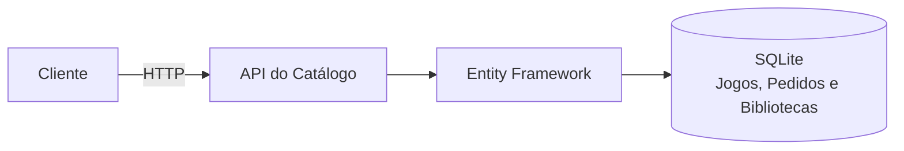
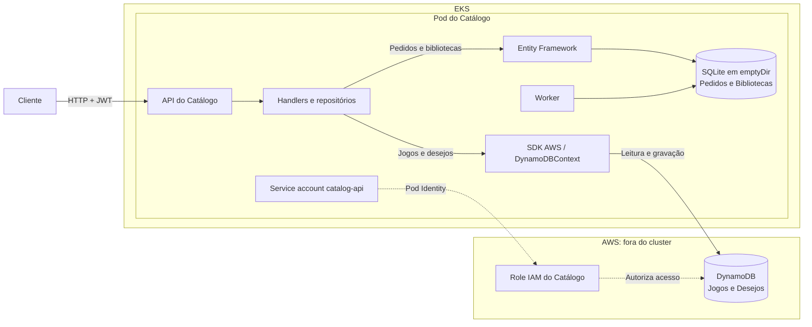

# Arquitetura do Catálogo: antes e agora

## Antes: persistência relacional

Jogos, pedidos e bibliotecas eram persistidos no SQLite. A lista de desejos ainda não existia nessa implementação.

## Agora: persistência poliglota no EKS

O SQLite do manifesto EKS é efêmero; o DynamoDB é um serviço gerenciado fora do cluster. No ambiente local, a API usa o DynamoDB Local em vez do serviço da AWS. O diagrama destaca a persistência do Catálogo, não todos os componentes da plataforma.
